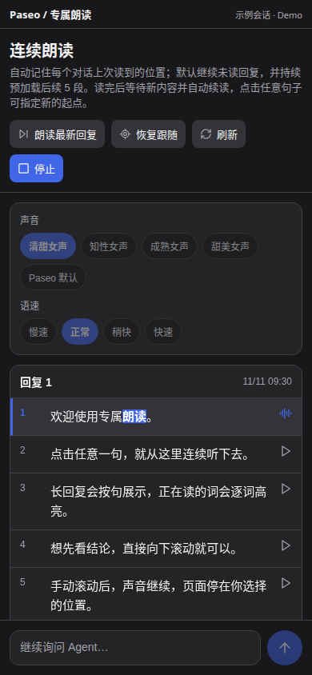

# Paseo Read Aloud

[简体中文](README.md) | **English**

Keep listening while you read ahead, ask a follow-up, or wait for the next reply. Paseo Read Aloud reads assistant responses continuously, highlights the spoken words, and remembers where you left off in each conversation.


Recorded from the plugin UI with a sample conversation. Both the GIF and video are silent. [Download the MP4 demo](docs/media/read-aloud-demo.mp4).

## Features

| Feature                  | What you can do                                                                                                                                           |
| ------------------------ | --------------------------------------------------------------------------------------------------------------------------------------------------------- |
| Continuous reading       | Start at the top or any sentence, then listen through later responses.                                                                                    |
| Jump to the latest reply | Select **朗读最新回复** to skip history and read the newest response from its first sentence.                                                             |
| Automatic continuation   | At the end, wait for a reply or more text and continue reading from the saved position.                                                                   |
| Browse while listening   | Scroll through the conversation at your own pace. Reading and word highlighting continue while automatic following is paused.                             |
| Follow the current line  | Select **恢复跟随** (“Resume following”) to jump back to the sentence being read and follow it again. Following stays paused until you select the button. |
| Follow-up chat           | Send a question to the same agent, model, and configuration without leaving the reading page.                                                             |
| Saved progress           | Keep a separate reading position for each conversation and continue with unread content.                                                                  |
| Audio preparation        | Preload the next 5 chunks in a rolling buffer, show loading states, and cache synthesized audio.                                                          |
| Voices and speed         | Choose from 4 MiniMax female voice presets and playback speeds of 0.8×, 1×, 1.2×, or 1.5×.                                                                |

Before synthesis, the plugin removes Markdown decoration, raw URLs, code blocks, generic attachment labels, and symbol-only paragraphs. It preserves readable headings, lists, tables, and link labels.

## Screenshots

Desktop: responses, reading controls, and a follow-up input on one page.


Browse while listening: manual scrolling keeps the active word highlighted without pulling the page back. Select **恢复跟随** to return to the current sentence.


<details>
<summary>See the compact layout and dark theme</summary>



</details>

## Install

Requires **Paseo 0.15.3 or later**.

1. Enable plugins under Paseo's **Settings → Plugins**.
2. Configure an OpenAI-compatible TTS service under **Settings → Voice**.
3. Install the plugin:

```bash
paseo plugin install github:danshuitaihejie/paseo-read-aloud
```

Open an agent conversation and select **朗读** beside its composer, or choose **打开专属朗读** in the Command Center. The plugin's current controls use Chinese labels.

The built-in female voice presets use MiniMax voice IDs. For another OpenAI-compatible service, choose **Paseo 默认** to use the voice from Paseo's settings.

For an existing GitHub installation, update to the latest features with:

```bash
paseo plugin update paseo-read-aloud
```

## Use

1. Select **从顶部开始** to start at the top, **继续朗读** to resume, or select any sentence. With a long history, select **朗读最新回复** to jump to the newest response, read it from the beginning, and resume following. You can switch while an earlier response is playing.
2. Type a question at the bottom and press Send while reading continues. Enter inserts a new line. Accepted messages clear the input; failed messages stay available for retry.
3. Keep the page open at the end of the content. New responses resume playback automatically.
4. Scroll to browse other content. Select **恢复跟随** to return to the current sentence, or **暂停跟随** to pause following explicitly. New replies do not re-enable following after you have paused it.
5. Select **停止** to stop reading and automatic continuation.

## TTS and data

The plugin reuses Paseo's existing TTS configuration without storing another API key. Text selected for reading goes to your configured TTS service, and the resulting audio plays on the current client. Follow-up questions go to the agent in the current conversation.

## Limits

- The page shows up to the 30 most recent readable assistant responses.
- Speech generation uses an OpenAI-compatible TTS endpoint. Paseo's built-in local speech models are not exposed to this plugin.
- Word timing is estimated from audio duration and text weights, rather than precise forced alignment.
- Web and desktop clients can stop audio immediately. Native mobile clients finish the current audio chunk when the host does not provide immediate stopping.
- Reading uses a separate page; the plugin does not add buttons to native message footers.

## Development

```bash
npm install --ignore-scripts
npm run typecheck
npx vitest run tests/read-aloud-panel.test.tsx --bail=1
paseo plugin install /absolute/path/to/paseo-read-aloud
```

After editing source files, check types and reload the plugin:

```bash
npm run typecheck
paseo plugin reload paseo-read-aloud
```

## License

[MIT](LICENSE)
