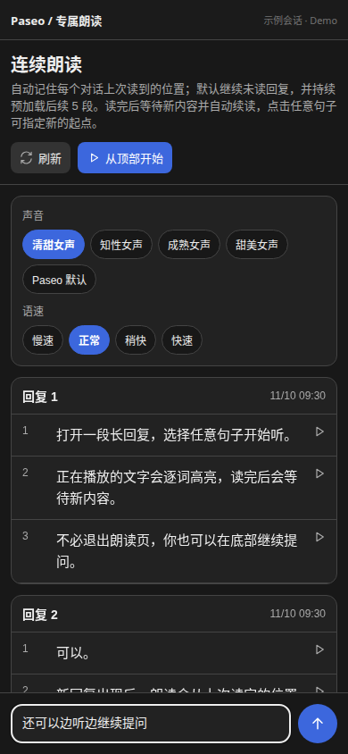

# Paseo 专属朗读

**简体中文** | [English](README.en.md)

在 Paseo 里边听边聊：连续朗读助手回复，从任意句子开始听，在同一页面继续提问，新内容出现后自动接着读。


演示使用插件真实界面和示例对话，GIF 和视频均为静音。[下载 MP4 演示](docs/media/read-aloud-demo.mp4)。

## 功能

| 功能       | 使用方式                                                         |
| ---------- | ---------------------------------------------------------------- |
| 连续朗读   | 从顶部或任意句子开始，连续播放后续回复。                         |
| 自动续读   | 读完当前内容后等待；新回复或追加内容出现时，从已读位置继续。     |
| 边听边聊   | 底部只有文字输入框和发送按钮，沿用当前 Agent 的模型和配置。      |
| 记住进度   | 按会话保存朗读进度，下次打开时继续未读内容。                     |
| 跟随阅读   | 近似逐词高亮，自动滚动到正在朗读的句子。                         |
| 提前准备   | 滚动预加载后续 5 个音频分段，显示加载状态，并缓存已合成的音频。  |
| 声音与速度 | 提供 4 种 MiniMax 女声预设，以及 0.8×、1×、1.2×、1.5× 四档语速。 |

朗读前会清理 Markdown 装饰、裸链接、代码块、通用附件标签和纯符号段落，保留可读的标题、列表、表格及链接名称。

## 界面

桌面布局：助手回复、朗读控制和底部输入框在同一页。


<details>
<summary>查看窄屏和深色布局</summary>



</details>

## 安装

需要 **Paseo 0.15.3 或更高版本**。

1. 在 Paseo「设置 → 插件」中启用插件功能。
2. 在「设置 → 语音」中配置 OpenAI 兼容的 TTS 服务。
3. 安装插件：

```bash
paseo plugin install github:danshuitaihejie/paseo-read-aloud
```

安装后，在会话输入框旁点击「朗读」，或在命令中心选择「打开专属朗读」。

内置女声预设使用 MiniMax 音色 ID。使用其他 OpenAI 兼容服务时，选择「Paseo 默认」，沿用语音设置中的音色。

## 使用

1. 点击「从顶部开始」或「继续朗读」，也可以直接点击任意句子。
2. 在底部输入问题并点击发送，播放会继续。Enter 用于换行；发送成功后清空输入，失败时保留内容供重试。
3. 读到末尾时保持页面打开，新回复出现后会自动继续。
4. 点击「停止」结束当前朗读及自动续读。

## TTS 与数据

插件复用 Paseo 已有的 TTS 配置，无需再保存一套 API 密钥。待朗读文本会发送到你配置的 TTS 服务，返回的音频在当前客户端播放。底部输入框把问题发送给当前会话的 Agent。

## 当前限制

- 页面最多展示最近 30 条可朗读的助手回复。
- 当前插件使用 OpenAI 兼容 TTS 端点，不能直接调用 Paseo 内置的本地语音模型。
- 逐词时间轴由音频时长和文本权重估算，不是精确的语音强制对齐。
- 网页和桌面端支持立即停止；原生移动端在宿主未提供即时停止能力时，会在当前音频分段结束后停止。
- 朗读位于独立页面，不会在原生消息底部插入按钮。

## 开发

```bash
npm install --ignore-scripts
npm run typecheck
npx vitest run tests/read-aloud-panel.test.tsx --bail=1
paseo plugin install /absolute/path/to/paseo-read-aloud
```

修改源码后，检查类型并重载插件：

```bash
npm run typecheck
paseo plugin reload paseo-read-aloud
```

## 许可证

[MIT](LICENSE)
